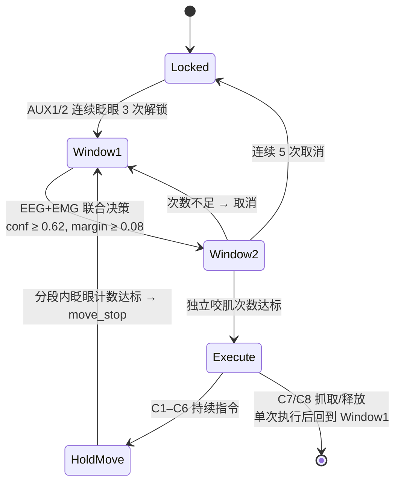

<div align="center">

# bci-arm-robot

**Asynchronous robotic arm control from 32-channel EEG, with EMG as the confirmation channel.**

基于运动想象的机械臂异步控制系统：EEG 只负责"想去哪"，咬肌 EMG 负责"确认执行"，两者分离以避免误触发。

[](#快速开始--quick-start)
[](#)
[](#测试--tests)
[](#)
[](#)

</div>

---

## 设计动机 / Why

纯运动想象的输出是**连续概率流**，不是离散指令：分类器在每个窗口都会给出一个"最可能"的动作，但用户并不总是在下指令。直接把它接到机械臂上，等于让每一次走神都变成一次位移。

本系统把控制拆成两层：

- **EEG 层只做候选**——EEG8 模型给出 C1–C8 候选与置信度，不直接驱动硬件；
- **EMG 层做确认**——咬肌（masseter）的自主收缩作为"提交"信号，且区分左右用于分组建模；
- **眨眼做急停**——C1–C6 进入持续移动后，分段眨眼计数达标即发送 `move_stop`。

> 一句话：**EEG 提议，EMG 确认，眨眼刹车。**

---

## 动作映射 / C1–C8 → Arm

任务标签与动作映射的**唯一代码源**是 [`arm_bci/eeg8_system.py`](arm_bci/eeg8_system.py) 中的 `CLASS_TO_ARM`：

| EEG 类别 | 采集任务 | 机械臂动作 | TCP 命令 |
|---|---|---|---|
| C1 | 左手运动想象 | 左移 | `move_left` |
| C2 | 右手运动想象 | 右移 | `move_right` |
| C3 | 双手运动想象 | 前移 | `move_forward` |
| C4 | 双脚运动想象 | 后移 | `move_backward` |
| C5 | 左手握拳 | 上移 | `move_up` |
| C6 | 右手握拳 | 下移 | `move_down` |
| C7 | 双手握拳 | 抓取 | `close_gripper` |
| C8 | 双脚执行 | 释放 | `open_gripper` |

> GUI、VR 与 TCP 接收端不得另写一份映射——单点定义是这套系统不出错的前提。

### 咬肌状态 → 候选组

窗口 1 的咬肌二进制状态只用于**缩小候选集**，不会单独发出命令：

| 咬肌状态（AUX3/AUX4） | 允许的 EEG 候选组 |
|---|---|
| `00` | C3 / C4 |
| `01` | C1 / C2 |
| `10` | C5 / C6 |
| `11` | C7 / C8 |

这相当于用 2 bit 的肌电信息把 8 类问题降成 2 类判别，同时保留用户对"要不要现在动"的完全控制权。

---

## 在线控制流程 / Online Flow



| 参数 | 默认值 | 说明 |
|---|---|---|
| `command_confidence` | 0.62 | 窗口 1 单窗置信度门限，不做跨窗平均补救 |
| `min_margin` | 0.08 | top-1 与 top-2 概率差门限 |
| 解锁 | 连续眨眼 3 次 | 静息锁定态的解锁条件 |
| 重锁 | 连续 5 次确认取消 | 防止无效确认堆积 |
| 窗口 1 / 窗口 2 | 可配置，必须与模型 `SignalConfig` 一致 | 窗口间隔 = 窗口时长，保证不重叠 |

**两条策略可选**：

- `eeg8_two_phase_masseter`（默认）——需要完整 32 EEG + 4 AUX，双阶段确认；
- `eeg8_two_phase_eeg_only`——不需要 AUX，通过 EEG 安全门限后只发送**有时长限制的一次性命令**，绝不进入持续移动。

---

## 输入契约 / Signal Contract

LSL 必须按顺序提供 **32 EEG + 4 AUX**：AUX1/2 为双眼眨眼，AUX3/4 为左/右咬肌。

启动时会拒绝以下情况，而不是自动修补：

- 采样率、前 32 路真实电极名或电极顺序与模型 `SignalConfig` 不一致；
- 使用 `CH1`/`EEG1` 这类占位标签（不会被替换成默认蒙太奇）；
- 加载旧 5 s 窗口模型、`HybridBCIModel`、或缺少 `model_format_version=1` 的 joblib。

> 系统不会裁剪、补零、转换或回退到旧运行链路。**契约不匹配就拒绝启动**，这是在线 BCI 系统最容易被忽略的安全设计。

---

## 快速开始 / Quick Start

```bash
# 1. 建环境
conda env create -f environment.yml
conda activate bciwork_1

# 2. 安装共享评测内核
pip install -e ../bci-bench[signal]

# 3. 启动（GUI / 控制台）
python arm_bci_system.py gui
python arm_bci_system.py --help
```

个人配置写入 `config/gui_defaults.json`（不入库），从 [`config/gui_defaults.example.json`](config/gui_defaults.example.json) 复制开始。

启动时会构建不可变的 `RuntimeSessionConfig`：模型窗口、阈值来源、AUX 计数目标、真实机械臂开关、主机端口与速度**全部冻结到本次会话**，运行中修改 GUI 不会改变已启动的输出。

### 输出分发

每条已接受的命令只构造一次 `RobotCommand`，经 `CommandPayloadFanout` 同步分发到：

- `KinematicOpenGLArmWidget.execute_payload` → 本地 VR 可视化（始终启用）；
- `NetworkRobotForwarder.execute_payload` → 真实机械臂（**默认关闭**，需在"参数配置 → 真实机械臂"显式启用）。

TCP 使用持久连接、4 字节大端长度前缀、UTF-8 JSON；限时位移会补发 `move_stop`。

---

## 训练契约 / Training Rules

- 训练记录与独立测试记录必须分开，同一条记录不得同时用于拟合与测试；
- 连续记录评测必须按 **trial / session 分组**，避免重叠窗口跨折泄漏；
- 窗口 1 时长改变后必须按相同设置**重新训练模型**——在线端拒绝不匹配的模型；
- 采集界面的 `epoch_seconds` 是提示/任务 trial 时长，**不是**模型输入窗口。

当前仓库内 `models/` 下的 joblib 是早期占位产物，不满足 2 s/2 s 上线契约。真实机械臂启用前必须按当前契约重新训练、完成独立会话验证。

---

## 结果状态 / Results Status

**本仓库目前没有可信的跨会话或在线识别率数据。** 现存数字只有两个，且都不能作为性能声明：

| 项目 | 现状 | 为什么不能引用 |
|---|---|---|
| 8 类分层交叉验证 | 60%（ExtraTrees） | 单文件、单会话、重叠窗口，折间泄漏，不是泛化结果 |
| 纯 MI 二分类离线 | 50%，kappa = 0.00（n = 20 窗口） | 样本过少且落在机会水平，混淆矩阵 `[[7,3],[7,3]]` |
| 跨会话 8 类 / 2 类 | ❌ **无数据** | 现有 `data/recordings/*.npz` 不包含 `trial_records_json`，无法重建试次边界 |
| 在线指令成功率 | ❌ **无数据** | 没有完整的在线会话记录（目标动作 → 实际执行） |
| EMG 确认延迟 | ❌ **无数据** | 未记录咬肌起始到命令下发的时间戳序列 |
| 误触发率 | ❌ **无数据** | 无静息态长时间记录 |

补齐前提：新录制必须在 npz 中写入 `trial_records_json`（每个试次的提示/任务/休息边界）。没有边界信息，任何跨会话评测都无法复算——这是当前所有数字缺失的根本原因，不是分析口径问题。

## 目录结构 / Layout

```
arm_bci-robot/
├── arm_bci/            # GUI、EEG8 训练/在线控制、纯 MI 解码、VR 与 TCP 协议
│   ├── eeg8_system.py  # CLASS_TO_ARM 与状态机（唯一映射源）
│   ├── pure_mi_decoder.py
│   └── domain/         # 领域模型与数据契约
├── config/             # 入库示例配置；本地 gui_defaults.json 被忽略
├── tests/              # 12 个模块：数据契约、状态机、协议、运行期安全
├── tools/              # 采集与评估辅助脚本
├── examples/           # 最小可运行示例
└── notebooks/          # 离线分析
```

数据、模型、日志目录均为占位（`.gitkeep`），实际内容不入库。

## 测试 / Tests

```bash
python -m compileall arm_bci
python -m unittest discover -s tests -v
```

测试覆盖：命令分发扇出、确认状态机、EEG8 数据契约、模型兼容性、咬肌运行时、在线通道契约、LSL 流与 EMG、机械臂协议、纯 MI 解码。

## 在项目群中的位置

离线读取、预处理、交叉验证与报告沉淀统一走 [bci-bench](https://github.com/periodgod/bci-bench)；本项目只保留与机械臂应用直接相关的入口与契约。同源范式另有 [bci-visual-app](https://github.com/periodgod/bci-visual-app)（SSVEP 脑控小车）与 [bci-rehab](https://github.com/periodgod/bci-rehab)（康复训练）。

---

<div align="center"><sub>World Robot Contest · BCI Event　|　数据与训练权重不随仓库分发</sub></div>
